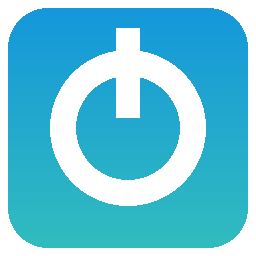

<p align="center">
  
</p>

<h1 align="center">WiiThemer Desktop</h1>

<p align="center">
  Build custom Wii System Menu themes on <b>Windows</b>, <b>macOS</b> and <b>Linux</b>.<br>
  A cross-platform desktop port of <a href="https://github.com/scooby7402976/wiithemer">WiiThemer</a>, where you can change every setting.
</p>

<p align="center">
  <a href="https://github.com/A-Hackers-Guide/wiithemer-desktop/releases/latest"></a>
  <a href="https://github.com/A-Hackers-Guide/wiithemer-desktop/actions/workflows/release.yml"></a>
  <a href="LICENSE"></a>
  <a href="https://a-hackers-guide.github.io/wiithemer-desktop/"></a>
</p>

---

## Table of contents

1. [What is this?](#what-is-this)
2. [Downloads](#downloads)
3. [Installing](#installing)
   - [Windows](#windows)
   - [macOS](#macos)
   - [Linux](#linux)
   - [Installing Wine (macOS and Linux)](#installing-wine-macos-and-linux)
4. [Quick start: your first theme](#quick-start-your-first-theme)
5. [Installing the theme on your Wii](#installing-the-theme-on-your-wii)
6. [The app, tab by tab](#the-app-tab-by-tab)
   - [Build Theme](#build-theme)
   - [Gallery](#gallery)
   - [Batch builds](#batch-builds)
   - [MYM Editor](#mym-editor)
   - [Catalog](#catalog)
   - [History](#history)
   - [Settings](#settings)
   - [Advanced (JSON)](#advanced-json)
   - [Log panel](#log-panel)
   - [Menus and keyboard shortcuts](#menus-and-keyboard-shortcuts)
7. [Customization reference](#customization-reference)
   - [Every setting](#every-setting)
   - [Output file name template](#output-file-name-template)
   - [The build pipeline](#the-build-pipeline)
   - [Adding System Menu versions](#adding-system-menu-versions)
   - [Hosting your own theme catalog](#hosting-your-own-theme-catalog)
   - [Sharing your setup](#sharing-your-setup)
   - [Languages and renaming any text](#languages-and-renaming-any-text)
8. [System Menu versions and regions](#system-menu-versions-and-regions)
9. [Channel spin options](#channel-spin-options)
10. [Built-in theme list](#built-in-theme-list)
11. [About .mym and .csm files](#about-mym-and-csm-files)
12. [Where files are stored](#where-files-are-stored)
13. [Command line (CLI)](#command-line-cli)
14. [Running and building from source](#running-and-building-from-source)
15. [How releases are made](#how-releases-are-made)
16. [Project layout](#project-layout)
17. [Troubleshooting](#troubleshooting)
18. [FAQ](#faq)
19. [Safety: read before installing themes](#safety-read-before-installing-themes)
20. [Credits](#credits)
21. [License and legal](#license-and-legal)
22. [Changelog](#changelog)

---

## What is this?

[WiiThemer](https://github.com/scooby7402976/wiithemer) (wiithemer.org) is a website by **scooby7402976** for building custom Wii Menu themes. You pick a theme, your System Menu version and your region. The server builds a `.csm` theme file for you to download.

**WiiThemer Desktop** does the same thing as a desktop app on your own computer:

- **No server.** Builds run on your machine, and nothing expires after 3 minutes.
- **Three platforms.** Windows `.exe`, macOS `.app` (as a `.dmg` or `.zip`), and Linux `.AppImage`.
- **Everything is customizable.** You can change:
  - the theme source and the catalog it comes from
  - the version and region
  - the spin mod and the output name
  - the exact build commands and the tools they use
  - the colors, fonts and layout of the app itself
- **Built-in `.mym` editor.** Open, edit and create theme mods without other tools.
- **The same 73 themes** as WiiThemer 1.0, downloaded only when you use them.

Release 1.0 of this project copies the build behavior of WiiThemer release [1.0](https://github.com/scooby7402976/wiithemer/releases/tag/1.0). It uses the same version table, the same order of steps, and the same "spin first" themes.

---

## Downloads

Go to the **[latest release](https://github.com/A-Hackers-Guide/wiithemer-desktop/releases/latest)**, or use these direct links:

| Platform | File | Notes |
|---|---|---|
| Windows 10/11 (x64) | [`WiiThemerDesktop-Windows.exe`](https://github.com/A-Hackers-Guide/wiithemer-desktop/releases/latest/download/WiiThemerDesktop-Windows.exe) | A single file. No installer needed. |
| macOS (Apple Silicon) | [`WiiThemerDesktop-macOS.dmg`](https://github.com/A-Hackers-Guide/wiithemer-desktop/releases/latest/download/WiiThemerDesktop-macOS.dmg) | Drag the `.app` to Applications. |
| macOS (Apple Silicon) | [`WiiThemerDesktop-macOS.app.zip`](https://github.com/A-Hackers-Guide/wiithemer-desktop/releases/latest/download/WiiThemerDesktop-macOS.app.zip) | The same `.app` as the `.dmg`, zipped. |
| macOS (Intel) | [`WiiThemerDesktop-macOS-Intel.dmg`](https://github.com/A-Hackers-Guide/wiithemer-desktop/releases/latest/download/WiiThemerDesktop-macOS-Intel.dmg) | For Intel Macs (v1.2.0 and later). |
| macOS (Intel) | [`WiiThemerDesktop-macOS-Intel.app.zip`](https://github.com/A-Hackers-Guide/wiithemer-desktop/releases/latest/download/WiiThemerDesktop-macOS-Intel.app.zip) | The same `.app` as the Intel `.dmg`, zipped. |
| Linux (x86_64) | [`WiiThemerDesktop-Linux-x86_64.AppImage`](https://github.com/A-Hackers-Guide/wiithemer-desktop/releases/latest/download/WiiThemerDesktop-Linux-x86_64.AppImage) | Works on most distros from 2022 onward (built on Ubuntu 22.04). |
| Linux (ARM64) | [`WiiThemerDesktop-Linux-aarch64.AppImage`](https://github.com/A-Hackers-Guide/wiithemer-desktop/releases/latest/download/WiiThemerDesktop-Linux-aarch64.AppImage) | Raspberry Pi 4/5 (64-bit OS), ARM laptops (v1.2.0 and later). |

**Which Mac do I have?** Apple menu → **About This Mac**. "Chip: Apple M…" means Apple Silicon. "Processor: Intel" means Intel.

Website with a theme gallery: **https://a-hackers-guide.github.io/wiithemer-desktop/**

---

## Installing

### Windows

1. Download `WiiThemerDesktop-Windows.exe`.
2. Double-click it.
3. Windows SmartScreen may say "Windows protected your PC" because the app isn't code-signed. Click **More info**, then **Run anyway**.
4. The theme builder (`themewii.exe`) needs the **.NET Framework**. Windows 10 and 11 already include it.

### macOS

1. Download the `.dmg`, open it, and drag **WiiThemerDesktop** into **Applications**. Or unzip the `.app.zip`.
2. The app isn't signed or notarized, so the first time you open it:
   - **right-click** (or Control-click) the app, choose **Open**, then click **Open** again, **or**
   - go to **System Settings → Privacy & Security** and click **Open Anyway**.
3. If macOS says the app "is damaged and can't be opened", that's the quarantine flag on downloaded files. Remove it with:

   ```bash
   xattr -dr com.apple.quarantine /Applications/WiiThemerDesktop.app
   ```

4. Install Wine, which the build step needs. See [Installing Wine](#installing-wine-macos-and-linux).

### Linux

1. Download `WiiThemerDesktop-Linux-x86_64.AppImage`.
2. Make it executable and run it:

   ```bash
   chmod +x WiiThemerDesktop-Linux-x86_64.AppImage
   ```

   ```bash
   ./WiiThemerDesktop-Linux-x86_64.AppImage
   ```

3. If you get an error about FUSE, install `libfuse2` (`sudo apt install libfuse2` on Ubuntu/Debian), or run it with `--appimage-extract-and-run`.
4. Install Wine, which the build step needs. See [Installing Wine](#installing-wine-macos-and-linux).

### Installing Wine (macOS and Linux)

The program that actually applies the theme, `themewii.exe`, comes from the original WiiThemer project and is a Windows .NET program. On macOS and Linux the app runs it through [Wine](https://www.winehq.org/).

**macOS** (with [Homebrew](https://brew.sh)):

```bash
brew install --cask wine-stable
```

**Ubuntu / Debian:**

```bash
sudo apt install wine
```

**Fedora:**

```bash
sudo dnf install wine
```

**Arch:**

```bash
sudo pacman -S wine wine-mono
```

The first time Wine runs, it may ask to install **Wine Mono**. Say yes, because themewii needs it. If your Wine command has a different name (for example `wine64`, or a full path to Wine), set it in **Settings → Tools → Wine command**.

---

## Quick start: your first theme

1. Open WiiThemer Desktop. The **Build Theme** tab lists all 73 built-in themes.
2. Type in the search box to filter, then click a theme to see its preview.
3. Pick your **System Menu version**. On the Wii: **Wii Settings**, then the number in the top-right corner, for example `4.3U`.
4. Pick your **Region**: the letter after the version (U = USA, E = Europe, J = Japan, K = Korea).
5. Pick a **Channel spin** (see [Channel spin options](#channel-spin-options)). `nospin` is the default.
6. Pick where to save (**Save to**). The default is a `WiiThemer` folder in your home folder.
7. Click **Build theme**. The log panel at the bottom shows each step. When it's done, a popup shows the path to your `.csm` file.

The first time you build a given version and region, themewii downloads the matching System Menu file. Later builds are faster.

---

## Installing the theme on your Wii

The app makes a `.csm` file. To install it you need a **softmodded Wii** (with the Homebrew Channel) and a theme installer such as **csm-installer** or **MyMenuify**. In short:

1. Copy the `.csm` file to the `themes` folder on your SD card or USB drive. The easiest way is **History → select the build → Copy to SD card…**, which also checks the copy. Check your installer's instructions for the exact folder it expects.
2. Open the installer from the Homebrew Channel, choose the theme, and install it.

**Before you do this, read [Safety](#safety-read-before-installing-themes).** Installing a theme built for the wrong version or region can brick a Wii that doesn't have protection.

---

## The app, tab by tab

### Build Theme

| Control | What it does |
|---|---|
| **Search box** | Filters the theme list as you type. |
| **Favorites only** | Shows only the themes you've starred. |
| **Random** | Selects a random theme from the current list. |
| **Sort** | A to Z, Z to A, Favorites first, Recently built, Most built, or By source. |
| **Theme list** | Every theme that isn't hidden. **★** marks favorites. The **Source** column says where it comes from: `catalog` (built in), `local` (a file on your computer) or `url` (a link). **Ctrl-click / Cmd-click / Shift-click** selects several themes; **Build theme** then builds all of them. |
| **★ button** | Stars or unstars the selected themes. |
| **Double-click / Enter** | Builds the selected theme(s) right away. |
| **Right-click** (Control-click on a Mac) | Opens a menu with Build, Batch build, Favorite, Hide, Remove (for themes you added), **Open in MYM Editor** (downloads the theme if needed and shows what's inside it) and Copy name. |
| **Open .mym…** | Adds a `.mym` file from your computer to the list. You can also pick a preview image (PNG/JPG/GIF/AVIF/WebP), or skip it. |
| **Add URL…** | Adds a theme by direct link to a `.mym` file, plus an optional preview image link. The file downloads when you build. |
| **Wii profile** | Saves and loads named setups (version, region, spin, spin-first, output folder, own System Menu file), for example "Living room Wii 4.3U" and "Kids' Wii 4.2E". Pick one from the list to load it, use **Save as…** to save the current options, and **Delete** to remove the selected one. |
| **My notes** | Your own notes for the selected theme ("installed on the kids' Wii", "use fastspin"…). Saved when you click away or press **Save note**. The search box searches notes too. |
| **Preview** | Shows the theme's preview image. Built-in previews come from the original WiiThemer repository and are saved for later. |
| **System Menu version** | `4.3`, `4.2`, `4.1` or `4.0`. |
| **Region** | `U`, `E`, `J` or `K`. |
| **Channel spin** | `nospin`, `spin`, `fastspin` or `transchan`. |
| **Apply spin first** | `auto` follows WiiThemer's rule (only Black Pirate, Matrix, Matrix Reloaded and Muse apply the spin mod first). `yes` and `no` force it either way. |
| **Save to** | The folder the finished `.csm` is copied to. |
| **Own System Menu .app** | Optional. Point this at your own copy of your System Menu content file (for example `00000097.app` dumped from your NAND). It's then used instead of downloading. |
| **Build theme** | Builds every selected theme for the chosen version and region. The app stays usable while it runs, and the progress bar shows how far along it is. |
| **Batch build…** | Builds the selected themes for **several versions and regions at once**. See [Batch builds](#batch-builds). |
| **Open output folder** | Opens the **Save to** folder in Explorer, Finder or your file manager. |
| **Test tools** | Checks that themewii is present and that Wine runs (on macOS/Linux), and prints what it found to the log. Run it first if builds fail. |

The app remembers everything you choose here for next time.

### Gallery

The whole theme list as a grid of thumbnails.

- Click **Load previews** to fetch the pictures. They download one at a time, about 4 MB in total for the built-in themes, and are saved for later.
- **Click any theme** to select it on the Build Theme tab.
- Hidden themes aren't shown, and themes you added appear with their own previews (a local file or a URL).
- In **Settings → Layout** you can set the number of columns and the thumbnail size, and turn on **Load gallery previews automatically** so the previews load whenever you open the tab (off by default, to save bandwidth).

### Batch builds

1. Select one or more themes (Ctrl-click / Cmd-click / Shift-click).
2. Click **Batch build…**.
3. Tick the version/region boxes you want. **All** ticks all 15 real combinations (4.0K doesn't exist, so it isn't offered), and **None** clears them.
4. Click **Build**.

Every combination is built one after another. When it's done, a summary lists what was built and what failed. Themes that don't exist for a region (for example Dark Wii Red on K) are reported as failed and skipped. This is useful for making one theme for every Wii in the house, or for publishing a theme for all regions.

### MYM Editor

A small editor for `.mym` theme mods. A `.mym` file is a zip archive: a `mym.ini` file plus images and other files.

| Button | What it does |
|---|---|
| **Open .mym** | Opens a `.mym` file and lists everything inside it. |
| **New** | Starts an empty `.mym` with a starter `mym.ini`. |
| **Add/replace file** | Adds files. If **one** item is selected and you pick **one** file, it replaces the selected item and keeps its name inside the archive. |
| **Extract** | Saves the selected item to your computer. |
| **Delete** | Removes the selected item. |
| **Save text** | Saves the text you edited (for example `mym.ini`) back into the archive. |
| **Save .mym as…** | Writes a new `.mym`, then offers to add it to your theme list. |

Click an item to view it. Text files open as editable text, and PNG/JPG/GIF files show as an image. Other files show their size, so you can extract them, edit them elsewhere, and add them back.

### Catalog

- **Base URL**: where built-in themes and previews are downloaded from. It points at the original WiiThemer 1.0 release by default:
  `https://raw.githubusercontent.com/scooby7402976/wiithemer/1.0/`
- **Show/hide selected**: hides themes you don't want in the Build list (you can select several).
- **Remove custom theme**: deletes a local or URL theme you added. Built-in themes can be hidden but not removed.
- **Clear download cache**: deletes saved `.mym` files and previews so they download fresh.
- **Apply**: saves the base URL.

### History

Lists your last builds (50 by default; change it in Settings → General): when, version, spin, and the file path. **Show file** opens the folder containing the selected build. **Copy SHA-256** copies the checksum of the selected build(s), so you can check a file you copied to an SD card or shared with someone. **Copy to SD card…** asks for your SD card or USB drive. It copies the selected builds into its `themes` folder (change it in Settings → General → Folder on SD card), creating the folder if needed, and checks that each copy's SHA-256 matches the original. The app remembers the drive for next time. **Clear history** empties the list (the files themselves aren't deleted).

### Settings

A form for the most common settings. Click **Apply** to save; the app redraws itself with the changes.

- **Color preset:** one click applies a whole color scheme: **Midnight** (default), **Wii Classic**, **Light**, **Dark Wii Red**, **Dark Wii Purple**, **Lime** or **High Contrast**. You can fine-tune any color afterwards.
- **Language:** English, **Español**, **Français**, **Deutsch** or **Português**, plus any language packs you add. See [Languages and renaming any text](#languages-and-renaming-any-text).
- **Layout:** choose which tabs are shown and in what order, for example `build, history, mym`. Build Theme and Advanced (JSON) are always shown so you can't lock yourself out. You can also show or hide the log panel and set its height.
- **Appearance:** widget style, font, font size, background, text, accent, text-on-accent, field and selection colors (each with a **Pick** color picker), preview width and window title.
- **Build:** output file name template, keep work folder, and also save the System Menu `.app`.
- **Tools:** a custom `themewii.exe`, the Wine command, use Wine on Windows, the themewii key argument, and the step timeout.
- **General:** check for updates when the app starts (on by default; it asks GitHub for the latest release and offers to open the download page), and how many history entries to keep.
- **Import… / Export…** settings as JSON, **Reset to defaults**, and **Check for updates** now.

### Advanced (JSON)

**Every** setting as editable JSON, including things the form doesn't show: the build pipeline, extra System Menu versions, the custom theme list, hidden themes and catalog paths. Edit it and press **Save**. If the JSON is invalid you get an error and nothing changes. **Restore default pipeline** puts back the original WiiThemer build steps.

### Log panel

The text box at the bottom of the window shows:
- each download
- each build step and the exact command it runs
- everything themewii prints
- any error, with the full details

### Menus and keyboard shortcuts

On macOS, use **Cmd** where the tables say Ctrl.

| Menu | Items |
|---|---|
| **File** | Open .mym theme…, **Import folder of .mym themes…**, Add theme from URL…, Build selected, Batch build…, Open output folder, Import/Export settings…, Quit |
| **View** | Jump to any tab, **Color preset ▸** (all presets), Bigger text, Smaller text, Clear log |
| **Help** | Website, User guide, Report a problem, Original WiiThemer, Open settings folder, Test tools, Check for updates, About |

| Shortcut | Action |
|---|---|
| Ctrl+O | Open a `.mym` theme |
| Ctrl+B | Build the selected theme(s) |
| Ctrl+Shift+B | Batch build… |
| Ctrl+F | Jump to the theme search box |
| Ctrl+1 … Ctrl+6 | Switch tabs |
| Ctrl+= / Ctrl+- | Bigger / smaller text (saved) |
| Ctrl+Q | Quit (saves the window size and position) |

**Import folder of .mym themes** adds every `.mym` file in a folder at once. If an image with the same name is next to a theme (for example `MyTheme.mym` and `MyTheme.png`), it becomes that theme's preview. Supported image types: `.png`, `.jpg`, `.jpeg`, `.gif`, `.webp`, `.avif`.

The app remembers its **window size and position** when you close it.

---

## Customization reference

### Every setting

Settings are stored in `settings.json` (see [Where files are stored](#where-files-are-stored)). Any key you leave out uses its default value.

#### `appearance`

| Key | Default | Description |
|---|---|---|
| `ttk_theme` | `"clam"` | Tk widget style (`clam`, `alt`, `default`, `classic`; plus `aqua` on macOS and `vista`/`xpnative` on Windows). |
| `font_family` | `"Helvetica"` | Font used throughout the app. |
| `font_size` | `11` | Base font size. Headers are 6 points larger. |
| `bg` | `"#1e1f26"` | Window background. |
| `fg` | `"#e8e8ee"` | Text color. |
| `accent` | `"#34b6e8"` | Accent color: main buttons, selected tab, headers. |
| `accent_fg` | `"#0b1016"` | Text color on top of the accent. |
| `field_bg` | `"#2a2c36"` | Background of inputs, lists and text boxes. |
| `select_bg` | `"#34b6e8"` | Background of selected rows. |
| `preview_size` | `360` | Largest preview image size, in pixels. |
| `window_geometry` | `"1100x720"` | Starting window size (and position), Tk style: `WIDTHxHEIGHT+X+Y`. |
| `window_title` | `"WiiThemer Desktop"` | Window title. |
| `language` | `"English"` | UI language. Bundled: English, Español, Français, Deutsch, Português. |
| `custom_strings` | `{}` | Your own wording for any label, button, tab or menu item: `{"Build Theme": "Make it!"}`. |
| `tabs` | `["build", "gallery", "mym", "catalog", "history", "settings", "advanced"]` | Which tabs are shown, in order. `build` and `advanced` are always added back if you leave them out. |
| `show_log` | `true` | Show the log panel at the bottom. |
| `gallery_columns` | `5` | Number of thumbnails per row in the Gallery. |
| `gallery_thumb` | `150` | Gallery thumbnail size, in pixels. |
| `gallery_autoload` | `false` | Load the Gallery previews as soon as the tab opens. |
| `log_height` | `8` | Height of the log panel, in lines. |

#### `build`

| Key | Default | Description |
|---|---|---|
| `version` | `"4.3"` | Last chosen System Menu version. |
| `region` | `"U"` | Last chosen region. |
| `spin` | `"nospin"` | Spin mod: a built-in name (`nospin`, `spin`, `fastspin`, `transchan`) **or a full path to your own `.mym`**. |
| `output_dir` | `~/WiiThemer` | Where finished `.csm` files go. |
| `filename_template` | `"{theme_name}{display}{spin_suffix}.csm"` | See [Output file name template](#output-file-name-template). |
| `keep_work_dir` | `false` | Keep the temporary build folder for debugging. Its path is printed in the log. |
| `save_base_app` | `false` | Also copy the downloaded System Menu file (`000000XX.app`) to the output folder. |
| `base_app_path` | `""` | Use your own System Menu content file instead of downloading one. |
| `run_first_override` | `"auto"` | `auto`, `yes` or `no`: whether the spin mod is applied before the theme. |
| `pipeline` | *(see below)* | The exact build commands. |
| `extra_versions` | `{}` | More System Menu versions, for example `{"4.3X": "ab"}`. |
| `profiles` | `{}` | Saved Wii profiles: `{"Name": {"version", "region", "spin", "run_first_override", "output_dir", "base_app_path"}}`. |

#### `tools`

| Key | Default | Description |
|---|---|---|
| `themewii_path` | `""` | Path to a different `themewii.exe`. Every file in its folder is copied into the work folder, so DLLs next to it are included. |
| `wine_command` | `"wine"` | The command that runs Windows programs on macOS/Linux. Arguments are allowed, for example `"wine64"` or `"/opt/wine/bin/wine"`. |
| `use_wine_on_windows` | `false` | Run themewii through Wine even on Windows. Rarely needed. |
| `key` | `"wiithemer_______Scooby74029"` | The key argument WiiThemer passes to themewii on every call. |
| `timeout_seconds` | `600` | Maximum time for each build step before it's stopped. |
| `min_output_mb` | `5.0` | If a built `.csm` is smaller than this, the log shows a loud **WARNING** that it may be broken. Set it to `0` to turn the warning off. |

#### `catalog`

| Key | Default | Description |
|---|---|---|
| `base_url` | WiiThemer 1.0 raw URL | Root of the theme library. Must end with `/`. |
| `mym_path` | `"mym/"` | Folder of `.mym` files inside the base URL. |
| `preview_path` | `"previewpics/"` | Folder of preview images inside the base URL. |
| `custom_themes` | `[]` | Themes you added: `{"name", "file", "preview", "source": "local" \| "url"}`. |
| `hidden_themes` | `[]` | Names of themes hidden from the Build list. |
| `favorites` | `[]` | Names of starred themes. |
| `sort` | `"name"` | Theme list order: `name`, `name_desc`, `favorites`, `recent`, `most_built` or `source`. |
| `notes` | `{}` | Your notes for each theme: `{"Theme name": "text"}`. |

#### `general`

| Key | Default | Description |
|---|---|---|
| `check_for_updates` | `true` | Ask GitHub for a newer release when the app starts. |
| `history` | `[]` | Past builds: `{"when", "theme", "display", "spin", "path", "sha256", "size"}`. |
| `history_limit` | `50` | How many history entries to keep. |
| `sd_folder` | `""` | The SD card or USB drive you last copied to. |
| `sd_subfolder` | `"themes"` | Folder on the card that **Copy to SD card…** puts files in. |
| `known_tabs` | `[]` | Used internally so tabs added in new versions appear once after updating, even if you customized `tabs`. |

### Output file name template

`build.filename_template` uses Python `str.format` placeholders:

| Placeholder | Example | Meaning |
|---|---|---|
| `{theme_name}` | `black_pirate` | The theme file name without `.mym`. |
| `{theme_label}` | `Black Pirate` | The name shown in the list. |
| `{display}` | `4.3U` | Version and region together. |
| `{version}` | `4.3` | Version only. |
| `{region}` | `U` | Region only. |
| `{appid}` | `97` | The System Menu content id. |
| `{spin}` | `nospin` | The spin choice as you entered it. |
| `{spin_suffix}` | `_nospin` | `_` plus the spin mod's file name. |

Examples:

- `{theme_name}{display}{spin_suffix}.csm` gives `black_pirate4.3U_nospin.csm` (the default, same as wiithemer.org)
- `{theme_label} ({display}).csm` gives `Black Pirate (4.3U).csm`
- `{region}/{theme_name}.csm`: subfolders are **not** created automatically, so stick to plain file names.

### The build pipeline

Every build runs a list of commands in a temporary work folder. That folder holds the themewii tools, the theme `.mym` and the spin `.mym`. There are two lists:
- `normal` is used for most themes
- `run_first` is used when the spin mod is applied first

The defaults match wiithemer.org's `index.php` exactly:

```json
"pipeline": {
  "normal": [
    "{themewii} {appid} {key}",
    "{themewii} {theme} {appid} 000000{appid}.app {key}",
    "{themewii} {spin} {appid}.app {output} {key}"
  ],
  "run_first": [
    "{themewii} {appid} {key}",
    "{themewii} {spin} {appid} 000000{appid}.app {key}",
    "{themewii} {theme} {appid}.app {output} {key}"
  ]
}
```

| Placeholder | Becomes |
|---|---|
| `{themewii}` | The themewii program. Gets `wine` in front of it on macOS/Linux. |
| `{theme}` | The theme `.mym` file name in the work folder. |
| `{spin}` | The spin `.mym` file name in the work folder. |
| `{appid}` | The System Menu content id, for example `97`. |
| `{output}` | The output file name from your template. |
| `{key}` | `tools.key`. |
| `{display}`, `{version}`, `{region}` | As in the file name template. |

Rules:
- A step that starts with `{themewii}` runs themewii (through Wine where needed).
- Any other step runs **as written** (and doesn't need Wine), so you can call other tools, for example `ASH.exe` (also bundled), your own scripts, or `7z`.
- The download step (`{themewii} {appid} {key}`) is skipped automatically when `000000{appid}` already exists, for example when you set **Own System Menu .app**.
- If any step exits with an error, the build stops and the log shows the output.
- After the last step, `{output}` must exist. It's then copied to your output folder.

**Example: stack an extra mod.** To apply a second `.mym` on top of the theme, put it next to your custom `themewii.exe` (its whole folder is copied into the work folder). Then add a step before the last one:

```json
"{themewii} my_extra_mod.mym {appid} 000000{appid}.app {key}"
```

### Adding System Menu versions

Add entries under `build.extra_versions` in the Advanced tab. Each maps `"<version><region>"` to a content id:

```json
"extra_versions": { "4.3X": "ab" }
```

The version and region boxes accept typed values, so type `4.3` and `X` to use it.

### Hosting your own theme catalog

1. Make a folder (a GitHub repo, a fork of WiiThemer, or any web server) with:

   ```
   mym/<file>.mym
   previewpics/<image>
   ```

2. Point **Catalog → Base URL** at its root, ending in `/`. For a GitHub repo:
   `https://raw.githubusercontent.com/<you>/<repo>/<branch>/`
3. The built-in list (names, files, previews, regions) comes from `app/catalog.json`. To change that list itself, edit `app/catalog.json` and run or build from source. Or add themes one at a time with **Add URL…**.

Region-specific themes use `{r}` in the file name. It's replaced with the region letter in lowercase (`dark_wii_red{r}.mym` becomes `dark_wii_redu.mym`), and `regions` lists which ones exist.

### Sharing your setup

Use **Settings → Export…** to save one `wiithemer-settings.json` with your colors, pipeline, custom themes and everything else. Someone else can load it with **Import…**. Custom themes that point to local files only work on the computer that has those files. Use URL themes for setups you share.

### Languages and renaming any text

Every tab name, button, label, column heading and menu item goes through a lookup table, so you can:

1. **Switch language:** go to **Settings → Language**, then **Apply**. Bundled packs: Español, Français, Deutsch, Português. Anything a pack doesn't cover stays in English.
2. **Rename anything yourself:** in **Advanced (JSON)**, add entries to `appearance.custom_strings`. Each maps the **English** text to what you want shown, and works on top of whichever language you picked:

   ```json
   "custom_strings": {
     "Build Theme": "Make it!",
     "Build theme": "🚀 Go",
     "Favorites only": "Just my faves"
   }
   ```

3. **Add a whole new language:** put `<Language name>.json` in a `lang` folder inside the settings folder (**Help → Open settings folder**), using the same `{"English text": "translation"}` format as [`app/lang/`](app/lang). It then shows up in the Language list. A file there with the same name as a bundled pack overrides it. Pull requests with new languages are welcome.

Text inside popups, and the long help paragraphs, aren't translated yet.

---

## System Menu versions and regions

These are the content ids WiiThemer uses (from `getappndisplayname()` in the original `index.php`):

| Version | U (USA) | E (Europe) | J (Japan) | K (Korea) |
|---|---|---|---|---|
| 4.3 | `97` | `9a` | `94` | `9d` |
| 4.2 | `87` | `8a` | `84` | `8d` |
| 4.1 | `7b` | `7e` | `78` | `81` |
| 4.0 | `72` | `75` | `70` | — (there was no Korean 4.0) |

Known limits, carried over from WiiThemer:
- **Dark Wii Red** wasn't officially made for the Korean region.
- WiiThemer noted that **4.0J** builds were broken at the time (the file came out too small). Check that the file size looks normal before installing.

---

## Channel spin options

These are small `.mym` mods, bundled in `app/spins/`, that change how the channel previews on the Wii Menu move:

| Option | Effect |
|---|---|
| `nospin` | Channels stay still (the default). |
| `spin` | Channels spin. |
| `fastspin` | Channels spin faster. |
| `transchan` | The transparent-channel mod. |
| *path to a `.mym`* | Your own mod used in the spin step. Set `build.spin` to its full path in the Advanced tab. |

---

## Built-in theme list

These 73 themes come from WiiThemer 1.0. They're downloaded from the original repository when you build or preview them. `{r}` means there's a separate file for each region.

| # | Theme | File | Regions |
|---|---|---|---|
| 1 | Animal Crossing | `animal_crossing.mym` | U, E, J, K |
| 2 | Bakugan | `Bakugan.mym` | U, E, J, K |
| 3 | Batman v1 | `batman_v1.mym` | U, E, J, K |
| 4 | Batman v2 | `batman_v2.mym` | U, E, J, K |
| 5 | Black Mage | `black_mage.mym` | U, E, J, K |
| 6 | Black Pirate | `black_pirate.mym` | U, E, J, K |
| 7 | Bleach | `bleach.mym` | U, E, J, K |
| 8 | Bowser | `bowser.mym` | U, E, J, K |
| 9 | Broly | `broly.mym` | U, E, J, K |
| 10 | Car | `car.mym` | U, E, J, K |
| 11 | Cars | `cars.mym` | U, E, J, K |
| 12 | Code Geass | `code_geass.mym` | U, E, J, K |
| 13 | Constantine | `constantine.mym` | U, E, J, K |
| 14 | Dark Wii Original | `dark_wii_original.mym` | U, E, J, K |
| 15 | Dark Wii Blue | `dark_wii_blue{r}.mym` | U, E, J, K |
| 16 | Dark Wii Green | `dark_wii_green{r}.mym` | U, E, J, K |
| 17 | Dark Wii Orange | `dark_wii_orange{r}.mym` | U, E, J, K |
| 18 | Dark Wii Pink | `dark_wii_pink{r}.mym` | U, E, J, K |
| 19 | Dark Wii Purple | `dark_wii_purple{r}.mym` | U, E, J, K |
| 20 | Dark Wii Red | `dark_wii_red{r}.mym` | U, E, J |
| 21 | Dark Wii White | `dark_wii_white{r}.mym` | U, E, J, K |
| 22 | Dark Wii Yellow | `dark_wii_yellow{r}.mym` | U, E, J, K |
| 23 | Deth Klok | `deth_klok.mym` | U, E, J, K |
| 24 | Discord | `Discord.mym` | U, E, J, K |
| 25 | Dragon Ball Z v1 | `dragon_ball_z_v1.mym` | U, E, J, K |
| 26 | Dragon Ball Z v2 | `dragon_ball_z_v2.mym` | U, E, J, K |
| 27 | Dr Who | `dr_who.mym` | U, E, J, K |
| 28 | Earth Bound | `earth_bound.mym` | U, E, J, K |
| 29 | Evil Dead | `evil_dead.mym` | U, E, J, K |
| 30 | Excite Bots | `excite_bots.mym` | U, E, J, K |
| 31 | Eyes | `eyes.mym` | U, E, J, K |
| 32 | Family Guy | `family_guy.mym` | U, E, J, K |
| 33 | Fantasy | `fantasy.mym` | U, E, J, K |
| 34 | Fight Club | `fight_club.mym` | U, E, J, K |
| 35 | Final Fantasy 7 | `final_fantasy_7.mym` | U, E, J, K |
| 36 | Futurama | `Futurama.mym` | U, E, J, K |
| 37 | Gaara | `gaara.mym` | U, E, J, K |
| 38 | Ghost Busters | `ghost_busters.mym` | U, E, J, K |
| 39 | Golden Sun | `golden_sun.mym` | U, E, J, K |
| 40 | Hand Drawn | `hand_drawn.mym` | U, E, J, K |
| 41 | Hello Kitty | `hello_kitty.mym` | U, E, J, K |
| 42 | Heros | `heros.mym` | U, E, J, K |
| 43 | Jurassic Park 3 | `jurassic_park_3.mym` | U, E, J, K |
| 44 | Kingdom Hearts | `kingdom_hearts.mym` | U, E, J, K |
| 45 | Leopard OS | `leopard_os.mym` | U, E, J, K |
| 46 | Lime Wii | `lime_wii.mym` | U, E, J, K |
| 47 | Luigi | `luigi.mym` | U, E, J, K |
| 48 | Mad World | `mad_world.mym` | U, E, J, K |
| 49 | Majoras Mask | `majoras_mask.mym` | U, E, J, K |
| 50 | Mario | `mario.mym` | U, E, J, K |
| 51 | Mario Kart | `Mario_Kart.mym` | U, E, J, K |
| 52 | Matrix | `matrix.mym` | U, E, J, K |
| 53 | Matrix Reloaded | `matrix_reloaded.mym` | U, E, J, K |
| 54 | Metroid | `metroid.mym` | U, E, J, K |
| 55 | Mortal Kombat | `mortal_kombat.mym` | U, E, J, K |
| 56 | Muse | `muse.mym` | U, E, J, K |
| 57 | Nightmare B4 Xmas | `nightmare_b4_xmas.mym` | U, E, J, K |
| 58 | Old School Nintendo | `old_school_nintendo.mym` | U, E, J, K |
| 59 | Psychedelic | `psychedelic.mym` | U, E, J, K |
| 60 | Ratchet and Clank | `ratchet_and_clank.mym` | U, E, J, K |
| 61 | Rockband 2 | `rockband_2.mym` | U, E, J, K |
| 62 | Shadow The Hedgehog | `shadow_the_hedgehog.mym` | U, E, J, K |
| 63 | Spiderman | `spiderman.mym` | U, E, J, K |
| 64 | Super Hero Squad | `super_hero_squad.mym` | U, E, J, K |
| 65 | Super Sonic | `super_sonic.mym` | U, E, J, K |
| 66 | The Simpsons | `the_simpsons.mym` | U, E, J, K |
| 67 | Thunder Cats | `thunder_cats.mym` | U, E, J, K |
| 68 | TMNT | `tmnt.mym` | U, E, J, K |
| 69 | Tomb Raider | `tomb_raider.mym` | U, E, J, K |
| 70 | True Blood | `true_blood.mym` | U, E, J, K |
| 71 | Win XP OS | `win_xp_os.mym` | U, E, J, K |
| 72 | Wolverine | `wolverine.mym` | U, E, J, K |
| 73 | Zelda | `zelda.mym` | U, E, J, K |

---

## About .mym and .csm files

- **`.mym`** is a theme *mod* in the MyMenuify format. It's a zip archive containing a `mym.ini` that lists which parts of the System Menu to replace, plus the replacement images and layout files. You can open and edit them in the [MYM Editor](#mym-editor).
- **`.csm`** is a complete, ready-to-install System Menu theme. It's the System Menu content file with the mod applied, for one specific version and region. **A `.csm` only works on the version and region it was built for.**
- **`000000XX.app`** is the original System Menu content file the theme is built from, for example `00000097.app` for 4.3U.

---

## Where files are stored

| What | Windows | macOS | Linux |
|---|---|---|---|
| Settings | `%APPDATA%\WiiThemerDesktop\settings.json` | `~/Library/Application Support/WiiThemerDesktop/settings.json` | `~/.config/WiiThemerDesktop/settings.json` (or `$XDG_CONFIG_HOME`) |
| Download cache | `...\WiiThemerDesktop\cache\` | `.../WiiThemerDesktop/cache/` | `~/.config/WiiThemerDesktop/cache/` |
| Built themes | `%USERPROFILE%\WiiThemer\` | `~/WiiThemer/` | `~/WiiThemer/` |
| Temporary build folders | Your system temp folder, `wiithemer_*` | same | same |

The exact settings path is also printed in the first line of the log panel. To start fresh, delete the `WiiThemerDesktop` folder.

---

## Command line (CLI)

Everything the Build tab does also works without the window, which is good for scripts and batch jobs. It uses your saved settings (pipeline, Wine command, catalog and so on) unless you pass `--settings`.

```
WiiThemerDesktop --cli [--list] [--theme NAME|PATH|URL ...] [--version V ...] [--region R ...]
                       [--all-versions] [--spin SPIN] [--out DIR] [--base-app FILE] [--settings FILE]
```

| Option | Meaning |
|---|---|
| `--list` | Prints every built-in theme and its regions. |
| `--theme` | A built-in theme name (not case-sensitive), a path to a `.mym`, or a URL. Repeat it for more themes. |
| `--version` / `--region` | Repeat these for more; every combination is built. Without them, your last-used version and region are used. |
| `--all-versions` | Builds all 15 real version/region combinations. |
| `--spin` | `nospin`, `spin`, `fastspin`, `transchan`, or a path to a `.mym`. |
| `--out` | Output folder. |
| `--base-app` | Your own System Menu `.app`. |
| `--settings` | Use this settings JSON (for example one you exported). |

The exit code is `0` when everything built and `1` if anything failed.

Examples:

macOS (the program inside the `.app`):

```bash
/Applications/WiiThemerDesktop.app/Contents/MacOS/WiiThemerDesktop --cli --list
```

Linux:

```bash
./WiiThemerDesktop-Linux-x86_64.AppImage --cli --theme "Black Pirate" --version 4.3 --region U --region E
```

From source (any platform):

```bash
python app/wiithemer_desktop.py --cli --theme "Dark Wii Blue" --all-versions --spin fastspin --out ./themes
```

On Windows, the `.exe` is a windowed app, so it can't print to the console. Use `start /wait WiiThemerDesktop-Windows.exe --cli ...` and check the output folder, or run from source to see the log.

---

## Running and building from source

You need **Python 3.10+** with **Tkinter**:
- Windows and python.org installers include Tkinter.
- On Homebrew: `brew install python-tk`.
- On Debian/Ubuntu: `sudo apt install python3-tk`.

```bash
git clone https://github.com/A-Hackers-Guide/wiithemer-desktop.git
```

```bash
cd wiithemer-desktop
```

```bash
pip install -r requirements.txt
```

```bash
python app/wiithemer_desktop.py
```

Check that the app starts without opening it (this is what CI runs):

```bash
python app/wiithemer_desktop.py --selftest
```

Package it yourself with PyInstaller (the same arguments CI uses):

```bash
pyinstaller --noconfirm --clean --windowed --name WiiThemerDesktop --icon packaging/icon.png --add-data app/catalog.json:. --add-data app/tools:tools --add-data app/spins:spins --add-data app/lang:lang --hidden-import PIL._tkinter_finder --hidden-import PIL.ImageTk app/wiithemer_desktop.py
```

- Windows: add `--onefile` to get one `.exe` in `dist/`.
- macOS: you get `dist/WiiThemerDesktop.app`.
- Linux: you get `dist/WiiThemerDesktop/`. See `.github/workflows/release.yml` for turning that into an AppImage with `appimagetool`.

`packaging/make_icon.py` regenerates `packaging/icon.png`. It only uses the Python standard library.

---

## How releases are made

All building happens on GitHub Actions (`.github/workflows/release.yml`), not on anyone's computer:

1. Every push to `main` and every pull request builds every target and runs `--selftest` and `--cli --list` (the Linux AppImages are also tested after packaging). README and website-only changes skip the builds.
   - Windows x64
   - macOS Apple Silicon and Intel
   - Linux x86_64 and ARM64

   `--selftest` opens every tab, selects and previews a theme, toggles favorites, applies all color presets, uses the MYM editor and history, and resets settings, all against a temporary settings file.
2. Pushing a tag like `v1.2.0` does the same, then publishes a GitHub Release with every `.exe`, `.dmg`, `.app.zip` and `.AppImage` attached, plus `SHA256SUMS.txt`.

   Check a download on macOS/Linux with:

   ```bash
   shasum -a 256 -c SHA256SUMS.txt --ignore-missing
   ```
3. The website is served by GitHub Pages from the `docs/` folder on `main`.

To make a release:

```bash
git tag v1.2.0
```

```bash
git push origin v1.2.0
```

---

## Project layout

```
wiithemer-desktop/
├── app/
│   ├── wiithemer_desktop.py   # the whole app (GUI, builder, MYM editor)
│   ├── catalog.json           # built-in theme list (name, file, preview, regions)
│   ├── lang/                  # language packs (Español, Français, Deutsch, Português)
│   ├── spins/                 # nospin / spin / fastspin / transchan .mym mods
│   └── tools/                 # themewii.exe, SharpZipLib, ASH.exe, 7z.exe (from WiiThemer)
├── docs/                      # GitHub Pages website (index.html, catalog.json, icon)
├── packaging/                 # icon, icon generator, Linux .desktop file
├── .github/workflows/         # cross-platform build and release
├── requirements.txt
└── LICENSE                    # GPL-2.0
```

---

## Troubleshooting

| Problem | Fix |
|---|---|
| **"themewii.exe is a Windows program. Install Wine…"** | Install Wine ([how](#installing-wine-macos-and-linux)). If it's installed under another name, set **Settings → Tools → Wine command**. |
| Wine asks to install Mono | Accept. themewii is a .NET program and needs it. |
| A step fails right away on Windows | Make sure the .NET Framework is installed and enabled (Control Panel → Programs → Turn Windows features on or off). |
| **Step 1 fails or hangs** (System Menu download) | themewii downloads from Nintendo's update servers, so check your internet connection. Or skip the download with **Own System Menu .app** (a NAND dump). |
| "Build finished but … was not created" | Turn on **Keep work folder**, rebuild, and look in the folder shown in the log. Compare the file names against your pipeline. |
| "… is not available for region K" | That theme has no file for your region (for example Dark Wii Red on K). |
| "System Menu 4.0K is not a known version" | There's no Korean 4.0. Add your own under `extra_versions` if you know what you're doing. |
| Previews don't show | You may be offline, or the base URL may be wrong. Previews need the Pillow library (included in the release builds). |
| A theme fails to download | Check **Catalog → Base URL**, then try **Clear download cache**. |
| The app looks broken after changing settings | **Settings → Reset to defaults**, or delete `settings.json`. |
| macOS says "damaged" | Run `xattr -dr com.apple.quarantine /Applications/WiiThemerDesktop.app`. |
| AppImage won't start | Run `chmod +x`, install `libfuse2`, or try `--appimage-extract-and-run`. |
| The text is too small or too big | **Settings → Font size**. |

When reporting a bug, include the full text of the log panel. [Open an issue](https://github.com/A-Hackers-Guide/wiithemer-desktop/issues).

---

## FAQ

**Does this need internet?**
The first time, yes: to download the theme, its preview, and (unless you supply one) the System Menu file. After that, cached themes build offline if you set **Own System Menu .app**.

**Is it the same as wiithemer.org?**
It runs the same tool (`themewii.exe`) with the same commands, the same versions, the same spin options and the same "spin first" rule. The differences are that it runs on your computer and that you can change everything.

**Can I use themes that aren't in the list?**
Yes. Use **Open .mym…** for a file on your computer, **Add URL…** for a link, or build your own in the **MYM Editor**.

**Can I use vWii (Wii U) or Wii mini?**
Their System Menus are different titles and aren't in the version table. Don't install these themes on them unless you know exactly what you're doing.

**Why isn't the macOS app signed?**
Signing needs a paid Apple Developer account. Follow the [macOS install steps](#macos) to open it.

**Why does the app download themes instead of bundling them?**
The theme library is about 680 MB, and the art belongs to its creators. Downloading on demand keeps the app small (about 15–30 MB) and gets the files from the original project.

---

## Safety: read before installing themes

Installing System Menu themes changes your Wii's most important software. A bad theme, or one built for the wrong version or region, can **brick** the console. Before installing any theme:

1. **Make a NAND backup** with BootMii, and keep it somewhere safe.
2. **Install Priiloader**, so you can recover if the menu won't load.
3. **Check that the version and region match** your Wii exactly (Wii Settings, top-right corner).
4. Check that the `.csm` file size looks normal: several MB, roughly the size of the original System Menu file. The app prints the size and warns you below 5 MB ([`min_output_mb`](#tools)).
5. Compare the SHA-256 in the log (or **History → Copy SHA-256**) with the file on your SD card, to make sure it copied correctly.

You use this software at your own risk. The authors aren't responsible for any damage.

---

## Credits

- **[scooby7402976](https://github.com/scooby7402976)**: WiiThemer, the `themewii` build tool, and the theme catalog this project is based on.
- **The theme creators** of every `.mym` in the WiiThemer library.
- **The MyMenuify and Wii homebrew communities** for the `.mym` / `.csm` formats and tooling.
- Bundled third-party pieces from the original repo: SharpZipLib (`ICSharpCode.SharpZipLib.dll`), 7-Zip (`7z.exe`), and `ASH.exe`.

## License and legal

This project is licensed under the **GNU General Public License v2.0**, the same as the original WiiThemer. See [LICENSE](LICENSE).

- Theme files and preview images are **not** in this repository. They're downloaded at runtime from the original project and belong to their creators. Many feature characters and artwork owned by third parties.
- This project is **not affiliated with or endorsed by Nintendo**. "Wii" is a trademark of Nintendo.
- No Nintendo software is included. System Menu files are downloaded by themewii from Nintendo's servers at build time, or supplied by you from your own console.

---

## Changelog

### v1.9.0
- **Copy to SD card…** on the History tab copies builds to your SD card's `themes` folder and checks each copy against its SHA-256.

### v1.8.0
- **Sorting**: A to Z, Z to A, favorites first, recently built, most built, or by source.
- **My notes**: write a note for any theme. Notes are saved automatically and the search box searches them too.
- A **Random** button picks a theme for you.
- Fix: **theme previews now show in the Linux AppImage** (PyInstaller was missing Pillow's Tk bridge). This affected Linux builds since v1.0.

### v1.7.0 (shipped as part of v1.8.0)
- A **Gallery tab**: a thumbnail grid of every theme. Click one to pick it. Previews load one at a time and only when you ask, unless you turn on auto-loading.
- Gallery columns, thumbnail size and auto-load settings.
- New tabs now appear after updating, even if you customized your tab layout.
- Fix: previews for themes added by URL now download correctly.

### v1.6.0
- **Languages**: Español, Français, Deutsch and Português, plus your own packs in the settings folder.
- **Rename any text**: `custom_strings` changes any label, button, tab or menu item.

### v1.5.0
- **Wii profiles**: save and switch between named setups for each console.
- **Layout control**: reorder or hide tabs, and show, hide or resize the log panel.
- Settings that are lists can be edited as comma-separated text in the Settings form.

### v1.4.0
- **Open any theme in the MYM Editor** from the right-click menu (it downloads the theme first if needed).
- A **size safety check**: a loud warning when a built `.csm` is suspiciously small (`min_output_mb`).
- A **SHA-256 checksum** for every build, shown in the log and saved in the History (with **Copy SHA-256**).
- Each release now includes **`SHA256SUMS.txt`** for all downloads.
- Fix: Wine is only required when a build step actually runs themewii.
- The self-test now runs a full build through the real Builder.
- Website: a region filter, a theme count, and a detail popup for each theme with a ready-to-copy CLI command.

### v1.3.0
- A **menu bar** (File / View / Help) and **keyboard shortcuts**.
- A **right-click menu**, plus double-click or Enter to build.
- **Import a whole folder** of `.mym` themes, using images with the same name as previews.
- Bigger/smaller text shortcuts, a color preset menu, and an About box.
- Remembers the window size and position.
- A broader self-test.

### v1.2.0
- New downloads: **macOS Intel** (`-Intel.dmg` / `-Intel.app.zip`) and **Linux ARM64** (`-aarch64.AppImage`).

### v1.1.0
- **Color presets**: Midnight, Wii Classic, Light, Dark Wii Red, Dark Wii Purple, Lime, High Contrast.
- **Favorites** (★) and a "Favorites only" filter.
- **Select several themes** and build them all at once.
- **Batch build** across any versions and regions, with a progress bar and a summary.
- **History** tab of past builds.
- **Open output folder** and **Test tools** buttons.
- **Update check** at startup (can be turned off) and on demand.
- **Command line mode** (`--cli`).
- A much broader self-test in CI, and updated GitHub Actions.

### v1.0.0
- First release: a cross-platform port of WiiThemer 1.0, with the Build Theme, MYM Editor, Catalog, Settings and Advanced (JSON) tabs.
